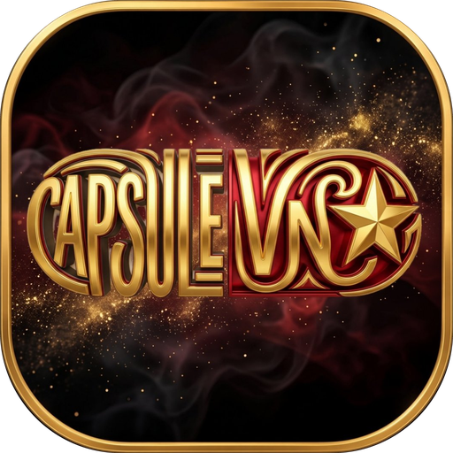
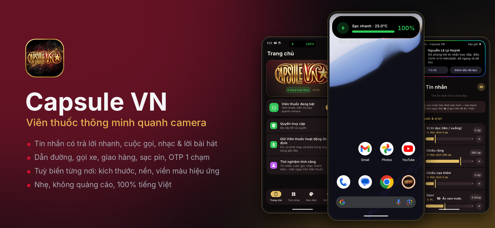
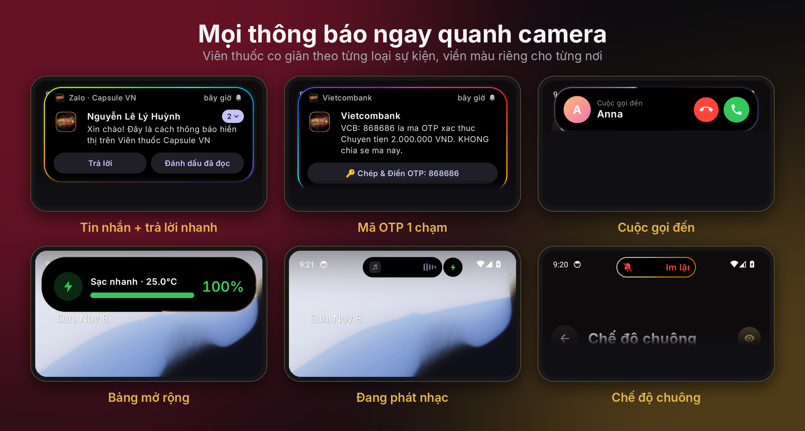
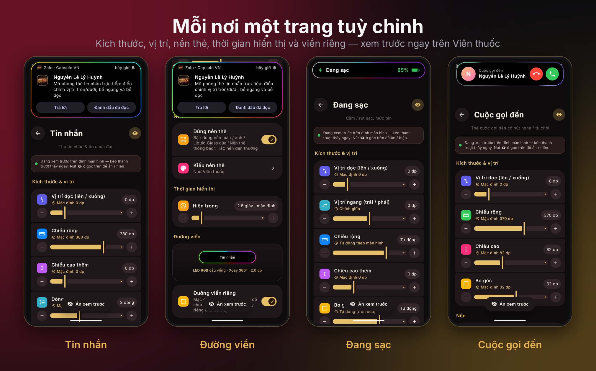
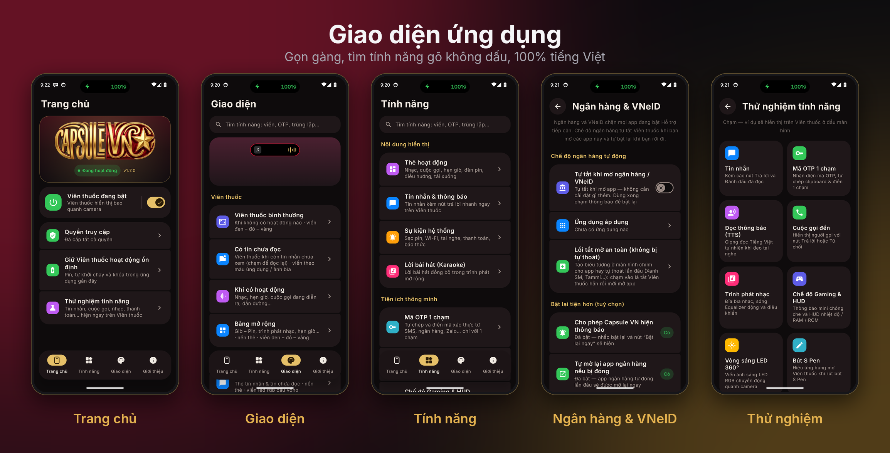
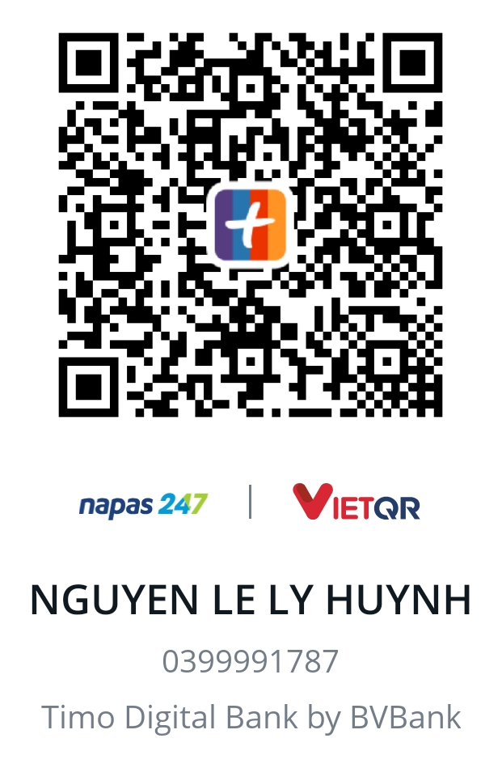

# 💊 Capsule VN

### Viên thuốc thông minh quanh camera cho Android — đẹp, nhẹ, 100% tiếng Việt

---

## ⬇️ Tải về & cài đặt

1. Vào **[Bản phát hành mới nhất](https://github.com/KagaTetsuo/Capsule-VN-Releases/releases/latest)** → tải file **`Capsule_VN.apk`**.
2. Mở file để cài (lần đầu Android sẽ hỏi cho phép cài từ nguồn này → **Cho phép**).
3. Mở Capsule VN → làm theo **Trang chủ → Quyền truy cập**:
   - **Hỗ trợ tiếp cận → Capsule VN → Bật** (để hiện Viên thuốc quanh camera).
   - **Truy cập thông báo → Capsule VN → Bật** (để hiện tin nhắn, cuộc gọi, nhạc…).
4. Nếu công tắc Hỗ trợ tiếp cận bị mờ / báo **"Cài đặt bị hạn chế"** (Android 13 trở lên):
   **Cài đặt → Ứng dụng → Capsule VN → ⋮ (góc trên) → Cho phép cài đặt bị hạn chế**, rồi quay lại bật Hỗ trợ tiếp cận.
5. Xong! Các bản sau **tự cập nhật ngay trong app** (thông báo "Đã có phiên bản mới").

> 💡 Máy Samsung: nếu tin nhắn hiện 2 lần (pop-up của app + Viên thuốc), vào **Tính năng → Biểu ngữ hệ thống** để tắt pop-up của từng app.

---

## ✨ Tính năng nổi bật

| | |
|---|---|
| 💬 **Tin nhắn có trả lời nhanh** | Zalo, Messenger, Telegram… hiện thành thẻ ngay quanh camera, trả lời không cần mở app; tin chưa đọc được giữ lại để xem sau. |
| 📞 **Cuộc gọi** | Thẻ cuộc gọi đến có nút nghe / từ chối, đếm giờ khi đang gọi; tự tránh hiện trùng với màn hình gọi của app. |
| 🎵 **Nhạc & lời bài hát** | Trình phát gọn đẹp, lời bài hát chạy theo nhịp (karaoke), sóng nhạc theo màu ảnh bìa. |
| 🧭 **Dẫn đường, gọi xe, giao hàng** | Thanh tiến trình kiểu Live Activity cho Google Maps, Xanh SM, Grab, Be, ShopeeFood… |
| 🔋 **Sự kiện hệ thống** | Sạc pin, tai nghe Bluetooth, thanh toán NFC, báo thức, chế độ chuông, Wi-Fi… |
| 🔑 **Mã OTP 1 chạm** | Tự chép & điền mã xác thực từ SMS, ngân hàng. |
| 🏦 **Chế độ ngân hàng** | Tự tạm tắt khi mở app ngân hàng / VNeID (vốn chặn Hỗ trợ tiếp cận) và tự bật lại khi rời đi. |
| 🎮 **Chế độ Gaming** | Thu gọn thông báo khi chơi game, bảng HUD nhiệt độ & RAM. |
| 🌙 **Màn hình tắt** | Tự nhận kiểu AOD của máy: AOD luôn hiển thị thì để AOD báo, còn không thì sáng màn hình báo rồi tự tắt. |

---

## 🎨 Tùy biến từng nơi, từng loại thông báo

Mỗi nơi của Viên thuốc là **một trang riêng** — kích thước, vị trí, nền, thời gian hiển thị và **đường viền riêng** (16 bảng màu, 14 hiệu ứng: xoay 360°, sao chổi, loang màu, nhịp thở, lấp lánh…).

---

## 📱 Giao diện ứng dụng

---

## 🔒 Quyền riêng tư

- **Không quảng cáo, không thu thập dữ liệu, không theo dõi.**
- Tin nhắn, mã OTP, danh bạ, cuộc gọi **chỉ xử lý trên máy**, không gửi đi đâu.
- Chỉ kết nối mạng để: kiểm tra bản cập nhật (GitHub) và tìm lời bài hát (LRCLIB; NetEase dự phòng — tắt được).

---

## 📝 Lịch sử phiên bản

Xem ghi chú từng bản tại **[Releases](https://github.com/KagaTetsuo/Capsule-VN-Releases/releases)** (cũng hiện trong app ở mục **Có gì mới**).

## ☕ Ủng hộ tác giả

Capsule VN **miễn phí, không quảng cáo** và được làm trong thời gian rảnh. Nếu app hữu ích với bạn, hãy **mời mình một ly cà phê** — mỗi sự ủng hộ, dù nhỏ, đều là động lực rất lớn để mình tiếp tục sửa lỗi và thêm tính năng mới. Cảm ơn bạn rất nhiều! ❤️

**NGUYEN LE LY HUYNH** · **0399991787** 
Timo Digital Bank by BVBank · quét bằng app ngân hàng / ví bất kỳ (VietQR · Napas 247)

Trong app: <b>Giới thiệu → Ủng hộ tác giả</b> có nút sao chép số tài khoản và lưu mã QR vào Thư viện.

## 👤 Tác giả

**Nguyễn Lê Lý Huỳnh** · Zalo hỗ trợ: **[0399991787](https://zalo.me/0399991787)**

© 2026 Capsule VN. Ứng dụng miễn phí, chia sẻ dưới dạng file cài đặt; mã nguồn không công khai.
